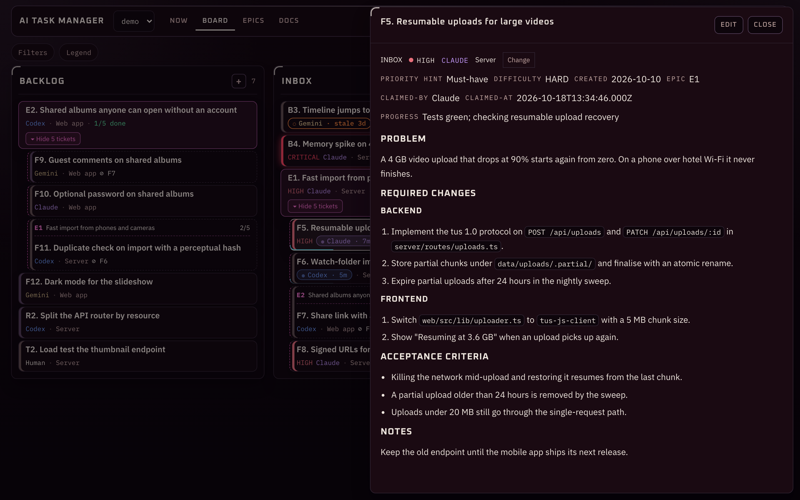

# AI Task Manager

> **Source, issues, and releases live on [GitLab](https://gitlab.com/technikatsu/ai-task-manager).** This repository is a showcase. Build and server commands below run from a [GitLab source checkout](https://gitlab.com/technikatsu/ai-task-manager).

A desktop or self-hosted browser kanban board for the markdown tickets your AI coding agents leave behind.

You point it at a project folder. It walks `ai-agent-workflow/backlog/`, `inbox/`, and `done/`, parses every `.md` file it finds, and renders the result as a kanban board. Claude, Codex, Gemini, Copilot, your favourite local model — they all write tickets into the same folder. You read, drag, edit, or reassign from the board. They pick up where they left off.

Built for the engineer whose last ticketing tool drained the joy out of every Tuesday. The agents create and execute; you set scope and stay oriented. Kanban-flavoured because the vocabulary is useful.



> **Upgrading from v1.x?** v2.0 has breaking changes for agent loops and scripts: `aiboard next` is gone, in a git repo `aiboard move … done` needs a commit naming the ticket, and agents now take `backlog/` work without waiting for you. Update the app, the CLI and your installed skills together. See [UPGRADING.md](https://gitlab.com/technikatsu/ai-task-manager/-/blob/main/UPGRADING.md).

## Install

Preferred runtime:
- macOS desktop app (Apple silicon, macOS 11 or later) from the [GitLab releases page](https://gitlab.com/technikatsu/ai-task-manager/-/releases)

Linux and Windows: build from source for now (see [Build From Source](#build-from-source) below). Pre-built binaries are macOS-only at the moment.

### First-time launch on macOS

The release `.app` isn't notarized, so macOS Gatekeeper will say it's "damaged" or from an "unidentified developer" the first time you double-click it. Your machine isn't doing anything wrong; that's the default for unsigned apps. Two ways to get past it:

```bash
xattr -dr com.apple.quarantine "/Applications/AI Task Manager.app"
```

Or right-click the `.app` → **Open** → **Open**. After that, regular double-clicking works forever.

Local development:

```bash
npm install
npm run tauri:dev
```

## Host on your local server

Run the GUI beside the Markdown files your agents manage, then open it from your
Mac or phone. From a source checkout on the server (Node.js 22.12+):

```bash
npm ci
npm run build
npm run serve -- --scan /srv/projects --host 0.0.0.0 --port 4400
```

Open `http://SERVER-LAN-IP:4400` in your browser. One server covers all your
projects: `--scan` serves every project with a board under that folder, and a
new one shows up on the next page load, no restart. `--root` adds a single
project from elsewhere; both flags repeat. The browser has
full ticket controls and automatically refreshes agent changes. No login or
browser folder picker is required. Everyone who can reach the service can edit
its boards, so use a trusted LAN/VPN. It also doesn't check the `Host` header yet, so a malicious website opened by someone on that network could reach the server through DNS rebinding; keep it off networks where people browse the open web, or put it behind a reverse proxy that pins the host name.

See [deployment instructions](https://gitlab.com/technikatsu/ai-task-manager/-/blob/main/deployment/README.md) for systemd, Docker,
permissions and simultaneous-edit behavior. The standalone `aiboard` CLI package
does not include this server; run it from the full source checkout. After a
rebuild, the server serves the new app on the next request; no restart needed.

## Why This Exists

Starting a project with AI is easy. Day one is great — you have an agent, a fresh idea, and momentum, and the first week feels like cheating.

Day thirty is a different story. You've been talking to Claude, Codex, Gemini, and yourself for weeks, and there are decisions in the codebase you can't quite trace back to anyone (although you suspect it was you, last Wednesday, around 1am). Half the work-in-progress lives in chat windows you've already closed, while the planning sits in your head where it helps nobody, including future-you.

I built this board for that Tuesday. When you point it at a project folder, it reads the same markdown files the agents are already touching, so you get a thing to actually look at: three columns, real cards, a detail pane. Your filesystem is the database, since the app's whole job is to render what's already in there. Uninstall the board tomorrow and your tickets will still be sitting in the folder, exactly the way the agent left them.

There are other tools in this space that store tasks in a JSON blob and let your agent talk to them through an IDE plugin. This is the opposite shape: every ticket is its own markdown file, you can `cat` one without the app, you can `git diff` what the agent changed, you can read your backlog on a server that has no GUI at all. The board exists because reading 80 markdown files in `inbox/` is faster as a column than as `ls`. The files are the truth.

## How To Use It

This part matters more than the UI: **work in tickets, not chat.**

- **Tell the agent to log findings as tickets.** Every bug it spots, every refactor it considers, every missing feature, every security finding — these become files in `ai-agent-workflow/`, where the board can surface them and next week's agent can find them again. Yes, even the small stuff. Especially the small stuff, actually.
- **Let the agent own ticket creation.** You *can* write tickets by hand, and sometimes I do, although the workflow is designed so that the agent does it. That way the friction of good ticket hygiene falls on the AI's shoulders, which is what those shoulders are there for.
- **Structure keeps the agent on rails — in both directions.** Every ticket has Problem, Required Changes, Acceptance Criteria, Notes, plus required metadata (severity, scope, assignee, status). *Going in*: the AI has to actually *think* before proposing anything, because vagueness gets pretty obvious once you have to write Acceptance Criteria for "fix the auth thing". *Coming back out*: when the same agent — or a different one tomorrow — picks up "B3. fix preview crash on large PDFs", the Problem is already stated, the Required Changes are listed, and the Acceptance Criteria are spelled out. Far less room for creative reinterpretation than "remember the auth thing we discussed last week".
- **You delegate via the `Assignee` field.** By default, the agent creating a ticket assigns it to itself, since it has the context and you haven't told it to do anything else. When you want a specific agent on a specific job — "give B2 to Gemini", "have Qwen pick up the EASY ones", "leave B3 for Marcus" — change the Assignee and the next session honors it. Any name works; the well-known agents (Claude, Codex, Gemini, Copilot, Human) get tone-styled badges, anything else (a local model, a teammate's first name, a fictional cat) renders neutral. The one hard rule: anything needing credentials, secrets, or production deploy access auto-routes to `Human`, because agents should not be holding your keys.

When you open the app on a project that doesn't yet have `ai-agent-workflow/`, you'll see a copy-pasteable prompt. Hand it to your agent, and the whole structure scaffolds itself.

## Autonomous Loops

The board is also the contract for set-and-forget agent runs. A scheduled agent (a cron job, a watchdog, a Codex Automation, an `@autonomous` skill, a `git push`-triggered CI agent — pick your flavour) works through `inbox/` and then `backlog/`, claims each ticket, and moves it to `done/` while you sleep. You mostly watch: to hold a ticket back, assign it to `Human`.

With the [`aiboard` CLI](https://gitlab.com/technikatsu/ai-task-manager/-/blob/main/cli/README.md), the mechanical parts are three lines:

```bash
export AIBOARD_AGENT=Codex                            # who the activity log should name
# the agent reads inbox/, then backlog/, and picks with context:
aiboard claim B12 || exit 0                          # exit 3 = another loop has it
# ...work the ticket, write verification notes under ## Notes...
git commit -am "Fix auth (B12)"                      # name the ticket in the commit
aiboard move B12 done                                # Status, Completed:, Commit:, claim — all handled
```

Deliberately, nothing here picks the ticket *for* the agent. A tool that ranks the inbox by severity gives a confident answer that can't see which ticket unblocks three others, or that last month's `CRITICAL` has stopped being one. Claiming is the part worth mechanising: it stops two concurrent loops taking the same ticket, and a claim older than two hours is treated as abandoned so a crashed run never wedges work.

The board you've been looking at is the same board the loop sees. Open the desktop app at any time to inspect what the autonomous agent has been up to, redirect with the Assignee field, or move tickets between columns. The files are the source of truth either way.

## Living Documentation

Tickets cover *changes*. Current state belongs in living docs.

The companion skill ([board-setup](https://gitlab.com/technikatsu/ai-task-manager/-/blob/main/skills/board-setup/SKILL.md)) also scaffolds a `documentation/` folder when the project actually warrants it — `CURRENT_STATE.md`, `ARCHITECTURE.md`, `SECURITY.md`, `DEPLOYMENT.md`, `DEVELOPMENT_GUIDE.md`, `ROADMAP.md`. Point-in-time things like audits or baselines live in `documentation/archive/` with a date in the filename, and they get left alone after that.

Both humans and AI agents read these — humans when they pick a project up after a break, agents when they reload after a context reset. The agent does the writing. Your job is to read it when you've been away too long.

Docs only stay true if they stay read, so each canonical doc is kept a **core**: the current truth in about a hundred lines, with depth pushed into linked topic files beside it (`ARCHITECTURE-data-flow.md` can be as long as it likes). `aiboard` keeps the habit honest — `doctor` flags a core that outgrows the cap, and every move to `done/` prints how stale each doc is, at exactly the moment "update the docs with the ticket" applies.

## Features

- **Now** — the front page for watching: Working / Ready / Blocked lanes with a HUD that counts them; live cards and rows carry a short cyan border tracer (static under reduced motion), and a claim that's gone quiet turns orange and names who holds it
- **Progress** — an agent posts a one-line status (`aiboard claim F42 --note "tests green"`); it shows on Now and in the activity panel and keeps the claim live
- **Since you last looked** — what happened while you were away ("Codex moved F12 to done, 2h ago"), runs folded into one line, with a per-browser marker and an "N new" count in the top bar
- **Board** — `backlog` / `inbox` / `done` with drag-and-drop anywhere in a column; filters fold into one control with removable chips; the ticket opens in an opaque read-first drawer with metadata changes behind Change; Compact and Comfortable density
- **Epics** — a feature's tickets carry `Epic: E1`; the Epics tab shows each outcome with its progress and narrows the Board to it in one click
- **Docs** — the living docs on their own page: the list, the doc at reading width, an outline that follows you, and a one-click prompt to have your agent write any canonical doc that's missing
- Full-text search across tickets *and* docs, with the matching line highlighted
- Cards wear their state: a severity edge and visible words for high and critical, a colour per agent, a live or stale claim pill, and ⊘ naming unmet `Depends:` links
- Every change leaves a trail in `activity.jsonl`; moves to done stamp the delivering commit
- Per-board `board.json`: your own Scope values, colours for your agents, an advisory WIP limit on `inbox/`
- The board refreshes itself, including edits an agent makes to a ticket in place; file-name sorting puts B2 before B10
- Many projects: scan a folder to add every project with a board (new ones appear at the next launch), and rename any board in the app without touching its folder. Self-hosted, one server covers a whole folder of projects (`--scan`), new ones included, no restart
- Runs as a macOS desktop app (Tauri), self-hosted in any browser, or as a Chromium local-file shell for development

## Required Board Layout

```text
project-root/
└── ai-agent-workflow/
    ├── backlog/
    ├── inbox/
    ├── done/
    │   └── archive/         # optional — `aiboard archive` files old tickets here by quarter
    └── documentation/       # optional — living docs, plus documentation/archive/ for audits
```

Task files are plain markdown. The app reads and updates them directly.

## Build From Source

```bash
npm install
npm run tauri:dev
```

Web development shell:

```bash
npm run dev
```

The local-file web development shell needs a Chromium-based browser (Chrome, Edge, Brave, Arc, etc.) — the board reads your local files via the File System Access API, which Firefox and Safari don't ship. For files on a server and browsers without the folder API, use [server mode](#host-on-your-local-server). The desktop build uses Tauri filesystem access.

Production build:

```bash
npm run tauri:build
```

Verification:

```bash
npm run check
npm test
```

## The Agent Skills

Three core skills cover the workflow's life cycle, with a Nightshift companion for unattended board campaigns. Each is a single markdown file you can install into other projects:

| Skill | Moment | File |
|---|---|---|
| **shape** | An idea, before it's work — interrogate it, size it, turn it into tickets | [skills/shape/SKILL.md](https://gitlab.com/technikatsu/ai-task-manager/-/blob/main/skills/shape/SKILL.md) |
| **board-setup** | A project without a board — scaffold folders, README, docs, first tickets | [skills/board-setup/SKILL.md](https://gitlab.com/technikatsu/ai-task-manager/-/blob/main/skills/board-setup/SKILL.md) |
| **ai-agent-workflow** | Every session after that — the ticket contract, picking work, moving to done, re-orienting after a context reset | [skills/ai-agent-workflow/SKILL.md](https://gitlab.com/technikatsu/ai-task-manager/-/blob/main/skills/ai-agent-workflow/SKILL.md) |
| **ai-agent-workflow-nightshift** | Authorized unattended Nightshift campaigns: board discovery, autonomous ticket lifecycle, local-first progress and bounded corrections | [skills/ai-agent-workflow-nightshift/SKILL.md](https://gitlab.com/technikatsu/ai-task-manager/-/blob/main/skills/ai-agent-workflow-nightshift/SKILL.md) |

The three core skills stand on their own. The board app is optional (the skills just write markdown), and so is the CLI — every CLI step has a documented manual fallback.

The Nightshift companion shares the base ticket contract; keep it beside `ai-agent-workflow` when packaging it. It uses an existing board, routes no-board briefs to internal Nightshift planning, and never creates a board automatically. It is an integration contract for campaign runtime support, not a runtime feature installer; deploy it with the supported campaign adapter once available.

### Claude Code

Skills live in a folder named after the skill. Per-project:

```bash
base=https://gitlab.com/technikatsu/ai-task-manager/-/raw/main
mkdir -p .claude/skills/{ai-agent-workflow,board-setup,shape}
curl -fsSL "$base/skills/ai-agent-workflow/SKILL.md" -o .claude/skills/ai-agent-workflow/SKILL.md
curl -fsSL "$base/skills/board-setup/SKILL.md"     -o .claude/skills/board-setup/SKILL.md
curl -fsSL "$base/skills/shape/SKILL.md"           -o .claude/skills/shape/SKILL.md
```

Or once for every project, swapping `.claude` for `~/.claude`. Claude Code picks them up automatically and loads whichever matches the task — no wiring needed. Installing only `ai-agent-workflow` also works; it points to the others when a task needs them.

### Codex

Same layout, different root — `~/.codex/skills/<name>/SKILL.md`. Run the Claude Code commands above with `~/.codex` in place of `.claude`.

### Cursor and other agents

Agents without a skill system read a conventions file instead. Drop the skill files in the repo and point at them, e.g. in `AGENTS.md`:

```markdown
## Task tracking
This project tracks work as markdown tickets in `ai-agent-workflow/`.
Read `skills/ai-agent-workflow/SKILL.md` before creating, picking up, or completing a ticket, and follow it.
Shaping ideas into tickets: `skills/shape/SKILL.md`. First-time setup: `skills/board-setup/SKILL.md`.
```

Pasting the contents inline works too — plain markdown, no tool-specific syntax.

### Then start it

Point your agent at a project and ask it to *"set up the ai-agent-workflow"*. It scaffolds the folders, writes the workflow README, and creates tickets for anything real it already knows about. From then on, ask for work in tickets rather than in chat.

### The `aiboard` CLI (optional)

[cli/README.md](https://gitlab.com/technikatsu/ai-task-manager/-/blob/main/cli/README.md) — a companion command-line tool for the same board, aimed at agents: it allocates ticket IDs, rewrites `Status` on moves, stamps `Created:`/`Completed:` dates and the delivering `Commit:`, claims tickets so concurrent loops don't collide, logs every write for the activity panel, archives long-finished work, warns when living docs go stale, and validates the whole contract. Skipping it costs you accurate dates and a linter, nothing more.

One-command install from the latest release:

```bash
npm install -g https://gitlab.com/technikatsu/ai-task-manager/-/releases/permalink/latest/downloads/aiboard.tgz
```

## License

MIT with an Attribution Addendum. See [LICENSE](https://gitlab.com/technikatsu/ai-task-manager/-/blob/main/LICENSE).

Free to use, modify, redistribute, and ship commercially. The one extra requirement: any fork or derivative that exposes a UI or documentation must keep a visible "Originally created by Technikatsu" attribution.

Made by [Technikatsu](https://technikatsu.com).
